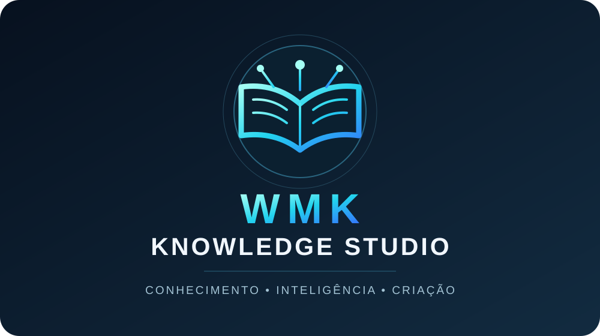

<p align="center"></p>

# WMK Knowledge Studio

**Transforme informação em conhecimento. Transforme conhecimento em inteligência.**

Plataforma aberta de pesquisa, estudo e conversação fundamentada em documentos, inspirada no Google NotebookLM e baseada no projeto [Open Notebook](https://github.com/lfnovo/open-notebook).

[](LICENSE)
[](https://github.com/WalneyNF/WMK-Knowledge-Studio/tree/wmk/windows-native)
[](https://github.com/WalneyNF/WMK-Knowledge-Studio/actions)

## Objetivo

Construir um núcleo de inteligência artificial reutilizável para pesquisa documental, desenvolvimento de software, educação e integração com aplicações WMK. Preservamos o motor original para evitar reconstruir RAG, persistência e integração com modelos do zero.

## Recursos herdados do Open Notebook

- Cadernos independentes, fontes e anotações.
- Importação de documentos, páginas web, áudio e vídeo, conforme os extratores disponíveis.
- Conversação contextual, pesquisa textual e vetorial, citações de fontes e transformações de conteúdo.
- Provedores locais e remotos, incluindo Ollama e Groq.
- Podcasts com perfis de apresentadores e provedores de síntese de voz compatíveis.
- API REST, interface multilíngue e proteção opcional por senha.

Esses recursos existem no projeto de origem; a homologação da distribuição WMK para Windows ainda está pendente.


## Arquitetura

| Componente | Tecnologia |
|---|---|
| Interface web | Next.js / React |
| API | Python 3.11 ou 3.12 / FastAPI |
| Orquestração | LangChain / LangGraph |
| Persistência e pesquisa | SurrealDB 2.x |
| Processamento em segundo plano | surreal-commands-worker |
| Integração com IA | Esperanto / provedores de modelos |

## Como testar no Windows sem Docker

A branch [wmk/windows-native](https://github.com/WalneyNF/WMK-Knowledge-Studio/tree/wmk/windows-native) contém o inicializador experimental. A branch main preserva a implementação original, além desta identidade e documentação.

Pré-requisitos: Git, Node.js 22 LTS, uv e executável SurrealDB 2.x no PATH; Python 3.12 pode ser provisionado pelo uv. FFmpeg para os recursos de áudio e vídeo. Não é necessário baixar um LLM grande para o primeiro teste se for usado Groq.

```powershell
git clone -b wmk/windows-native https://github.com/WalneyNF/WMK-Knowledge-Studio.git
cd WMK-Knowledge-Studio
```

Execute DIAGNOSTICO.bat, confira os requisitos e depois INSTALAR.bat. O instalador prepara as dependências Python e Node e inicia os serviços; **não instala automaticamente os pré-requisitos globais**. Nas próximas execuções, use INICIAR.bat. Mantenha a janela aberta e encerre com Ctrl+C. TESTAR.bat executa um teste finito de inicialização com os serviços parados.

- Interface: http://127.0.0.1:3000
- API: http://127.0.0.1:5055/docs
- Banco: loopback, porta 8000.
- Logs: wmk-logs/; preserve .env, data/ e surreal_data/.

[Manual Windows](https://github.com/WalneyNF/WMK-Knowledge-Studio/blob/wmk/windows-native/WMK-WINDOWS.md) · [GitHub Actions](https://github.com/WalneyNF/WMK-Knowledge-Studio/actions)

A instalação tradicional por Docker continua documentada no [guia original](docs/1-INSTALLATION/docker-compose.md). O compose original utiliza a imagem upstream, não uma distribuição WMK personalizada.

## Primeiro laboratório

1. Abra Manage → Models (Gerenciar → Modelos).
2. Cadastre Groq para geração de texto, teste a conexão e selecione um modelo disponível, por exemplo openai/gpt-oss-20b se oferecido.
3. Cadastre Ollama com URL http://127.0.0.1:11434 e um modelo de embeddings disponível e compatível. Groq não oferece embeddings na integração original.
4. Configure os modelos padrão de linguagem e embeddings.
5. Crie um caderno de laboratório e importe [projeto-ficticio.md](https://github.com/WalneyNF/WMK-Knowledge-Studio/blob/wmk/windows-native/laboratorio/projeto-ficticio.md).
6. Aguarde o processamento e pergunte pelo código, orçamento, responsável e data de lançamento. Verifique as citações, informações ausentes e perguntas de seguimento.
7. Feche e reabra, verificando a persistência.

Não use documentos confidenciais até validar o fluxo de dados. Groq é remoto e recebe o contexto encaminhado ao modelo; embeddings locais não tornam o chat remoto privado.

## Roadmap WMK

| Etapa | Estado |
|---|---|
| Identidade e documentação em português | Publicadas |
| Inicialização nativa e diagnóstico Windows | Experimental |
| CI de sintaxe e arquivos | Configurada; verificar resultado |
| Homologação de chat, fontes, RAG e persistência | Pendente |
| Laboratório de contexto, tokens e recuperação | Planejado |
| Cadastro de agentes, ferramentas e equipes | Planejado |
| Pipelines com execução inspecionável | Planejado |
| Estúdio de relatórios, cronologias e mapas mentais | Planejado |
| API central para aplicações WMK | Planejado |

Não apresentamos itens planejados como funcionalidades prontas.

## Desenvolvimento e documentação

- [Instalação a partir do código](docs/1-INSTALLATION/from-source.md)
- [Arquitetura original](docs/7-DEVELOPMENT/architecture.md)
- [Cadernos, fontes e notas](docs/2-CORE-CONCEPTS/notebooks-sources-notes.md)
- [Guia do usuário](docs/3-USER-GUIDE/index.md)
- [Provedores de IA](docs/4-AI-PROVIDERS/index.md)
- [Referência REST](docs/7-DEVELOPMENT/api-reference.md)
- [Segurança](docs/5-CONFIGURATION/security.md)
- [Contribuição](CONTRIBUTING.md)
- [Histórico upstream](CHANGELOG.md)
- [README original em inglês](README.upstream.md)

## Créditos e licença

**Adaptação WMK:** Walney Moreira Klein — walneyk@hotmail.com.

**Projeto original:** Luis Novo e colaboradores do [Open Notebook](https://github.com/lfnovo/open-notebook). Agradecemos o trabalho da comunidade original. O aviso de copyright e a licença [MIT](LICENSE) permanecem preservados.

Projeto independente, sem afiliação com Google ou NotebookLM.

